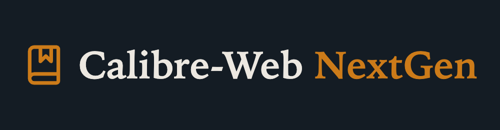
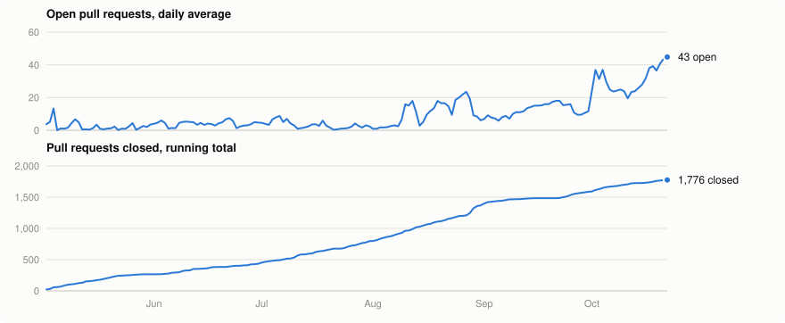
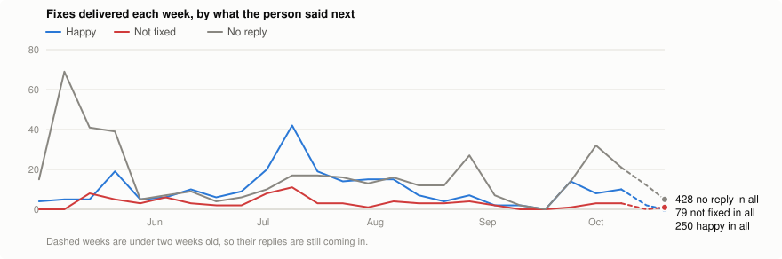

<p align="center">
  
</p>

[](https://github.com/new-usemame/Calibre-Web-NextGen/releases/latest)
[](https://github.com/new-usemame/Calibre-Web-NextGen/pkgs/container/calibre-web-nextgen)
[](https://github.com/new-usemame/Calibre-Web-NextGen/issues)
[](https://github.com/sponsors/new-usemame)

Calibre-Web-NextGen (CWNG) is a self-hosted ebook library you use from a browser, an e-reader or any OPDS app. It's built on [Calibre-Web-Automated](https://github.com/crocodilestick/Calibre-Web-Automated) (CWA) and works as a drop-in replacement for its Docker image. Community fixes and new features ship in frequent releases.

---

## Switch from upstream CWA

Change one line in your compose file:

```diff
- image: crocodilestick/calibre-web-automated:latest
+ image: ghcr.io/new-usemame/calibre-web-nextgen:latest
```

Then pull and recreate the container:

```bash
docker compose pull && docker compose up -d
```

Your library, settings, users, OAuth tokens and KOReader sync state live in your volumes and carry over. To switch back, reverse the line.

Run Docker from a NAS or a web UI instead of a terminal? Follow the step-by-step guide for your platform. Each one covers a fresh install and a switch from CWA, button by button: [Synology](docs/install/synology.md) · [Unraid](docs/install/unraid.md) · [Portainer](docs/install/portainer.md) · [TrueNAS SCALE](docs/install/truenas.md) · [all guides](docs/install/). If your screens don't match, [open an issue](https://github.com/new-usemame/Calibre-Web-NextGen/issues) or [ask on Discord](https://discord.gg/B8NXZmcp32).

- New install? Start with the [Quick start](#quick-start).
- Found a bug? [File it here](https://github.com/new-usemame/Calibre-Web-NextGen/issues/new?template=bug_report.yml).
- Have an idea, even a half-formed one? [Open a feature request](https://github.com/new-usemame/Calibre-Web-NextGen/issues/new?template=feature_request.yml). No checklist required.
- Setting up with an AI assistant? Point it at [`AI_README.md`](AI_README.md), a guide written for the assistant to follow, verify and hand back to you working.
- AI does much of the development work on this fork and none of the work in the app you run. [How AI is used](#how-ai-is-used) explains the review gates.
- Want to back the work? [Sponsor on GitHub](https://github.com/sponsors/new-usemame), one-time or monthly. Nothing is paywalled.

---

## Progress tracker

<!-- progress-tracker:start (regenerate with scripts/progress_tracker.py; do not hand-edit) -->
<picture>
  <source media="(prefers-color-scheme: dark)" srcset="README_images/progress-throughput-dark.svg">
  
</picture>

<picture>
  <source media="(prefers-color-scheme: dark)" srcset="README_images/progress-outcomes-dark.svg">
  
</picture>

On October 24, 2026, 43 pull requests were open and 1,791 closed, 1,641 of them merged. Of 774 fixes delivered to a person, 33% heard back happy, 10% not fixed and 56% got no reply. When someone did answer, the answer was happy 76% of the time.

A fix is one moment someone was told their problem was dealt with: a fix PR merged for their issue, their issue closed as done, their own PR merged or closed, or our note on an upstream CWA or Calibre-Web thread pointing them to a fix here. Happy means they then said it works or were content with it. Not fixed means they reopened it, said it is still broken in whole or part, or were unhappy with how it went, and every close in a close-and-reopen cycle counts. No reply means nothing came back. Each reply is judged against [a written rubric](docs/progress-tracker/JUDGING.md) by one model and checked by a second; where they disagree the thread is reread and settled. Every verdict and the quote behind it are in [docs/progress-tracker](docs/progress-tracker/). Replies on Discord and Reddit are not counted.

<details><summary>The numbers by month</summary>

| Month | PRs opened | PRs closed | Open, daily average | Happy | Not fixed | No reply |
|---|---:|---:|---:|---:|---:|---:|
| May 2026 | 270 | 266 | 2 | 38 | 16 | 169 |
| Jun 2026 | 168 | 168 | 4 | 32 | 13 | 26 |
| Jul 2026 | 359 | 362 | 3 | 107 | 26 | 70 |
| Aug 2026 | 578 | 573 | 11 | 35 | 14 | 71 |
| Sep 2026 | 224 | 218 | 12 | 23 | 5 | 32 |
| Oct 2026 | 235 | 204 | 32 | 23 | 6 | 68 |

Regenerate with `python3 scripts/progress_tracker.py fetch`, then `queue`, judge the new replies, `apply` and `render`.

</details>
<!-- progress-tracker:end -->

---

## Table of contents

Prefer separate pages with a sidebar? The same guides are on the searchable [docs site](https://wiki.calibrewebnextgen.com) and in the [project wiki](https://github.com/new-usemame/Calibre-Web-NextGen/wiki).

- [Why this fork exists](#why-this-fork-exists)
- [What's included](#whats-included)
- [Quick start](#quick-start)
- [Full Docker Compose setup](#full-docker-compose-setup)
  - [What goes in each volume](#what-goes-in-each-volume)
  - [Running with Podman](#running-with-podman)
- [First run](#first-run)
- [Updating](#updating)
- [Migrating](#migrating)
  - [From upstream CWA](#from-upstream-cwa)
  - [From stock Calibre-Web](#from-stock-calibre-web)
- [Pair with Shelfmark](#pair-with-shelfmark)
- [Common configurations](#common-configurations)
  - [Network shares (NFS, SMB, ZFS)](#network-shares-nfs-smb-zfs)
  - [Calibre desktop coexistence](#calibre-desktop-coexistence)
  - [Calibre plugins (DeDRM and others)](#calibre-plugins-dedrm-and-others)
  - [Reverse proxy / Cloudflare Tunnel](#reverse-proxy--cloudflare-tunnel)
  - [Reverse proxy with a prefix](#reverse-proxy-with-a-prefix)
  - [Hardcover metadata provider](#hardcover-metadata-provider)
  - [KOReader sync](#koreader-sync)
  - [Kobo sync](#kobo-sync)
  - [Writable cache storage](#writable-cache-storage)
- [Troubleshooting](#troubleshooting)
- [Differences from upstream](#differences-from-upstream)
- [Translations](#translations)
- [Contributing](#contributing)
- [Supporting the project](#supporting-the-project)
- [How AI is used](#how-ai-is-used)
- [Credits](#credits)

---

## Why this fork exists

The goal is to get fixes to users quickly. Community pull requests, including ones waiting in CWA's queue, are reviewed and merged here, and bugs reported here get fixed whether or not someone has sent a patch. Feature work follows what people ask for in the issue tracker, and all of it ships in regular releases.

The data format and configuration match upstream CWA, so switching images is reversible and needs no migration in either direction.

---

## What's included

CWNG is built on CWA and adds the changes listed in [`CHANGES-vs-upstream.md`](CHANGES-vs-upstream.md). Some you'll notice:

- A redesigned interface, the New UI, with the Classic interface still available.
- On a Kindle or any e-reader running KOReader, the plugin opens on your library's covers, downloads a book when you tap it, and syncs position, read status and highlights back. See [Your library on a Kindle](docs/koreader-kindle.md).
- Kobo sync of the shelves you choose, which appear on the device as collections. See [Choosing which books go to your Kobo](docs/kobo-shelves.md).
- [Reading status](docs/reading-status.md), [ratings](docs/personal-book-ratings.md) and [private reviews](docs/private-book-reviews.md) kept per account.
- Sharper covers for high-DPI e-readers, a [cover designer](docs/cover-designer.md) for books that have none, and [ISBN lookup inside book files](docs/file-isbn.md).
- [Book sources (Beta)](docs/book-sources.md): request books from OPDS catalogs and Newznab/Torznab indexers and have them imported through the normal ingest. New UI only, off by default.
- A Docker healthcheck that also fails when the library database, the ingest service or the metadata-change service is down.
- An update helper in the app that gives the exact update command for your setup.

---

## Quick start

You need Docker with Docker Compose.

1. Make folders for your library:

   ```bash
   mkdir -p ~/calibre-web/{config,library,ingest}
   cd ~/calibre-web
   ```

2. Save this as `docker-compose.yml`:

   ```yaml
   services:
     calibre-web:
       image: ghcr.io/new-usemame/calibre-web-nextgen:latest
       container_name: calibre-web
       environment:
         - PUID=1000
         - PGID=1000
         - TZ=America/New_York   # change to your timezone
       volumes:
         - ./config:/config            # settings, user db, logs
         - ./library:/calibre-library  # books live here
         - ./ingest:/cwa-book-ingest   # drop new books here to import
       ports:
         - 8083:8083
       restart: unless-stopped
   ```

3. Start it:

   ```bash
   docker compose up -d
   ```

4. Open `http://localhost:8083`, sign in as `admin` / `admin123`, and change the password.

Drop an `.epub` into `./ingest/` and it shows up in your library within a few seconds.

> Files in your library and ingest folders should belong to your `PUID:PGID` user (1000 by default), not root. If you copied books in as root, fix that once with `sudo chown -R 1000:1000 ~/calibre-web`.

---

## Full Docker Compose setup

A fuller compose file, with a comment on each option:

```yaml
services:
  calibre-web:
    image: ghcr.io/new-usemame/calibre-web-nextgen:latest
    container_name: calibre-web
    environment:
      # Match your host user and group (run `id` to see them) so the
      # container and the host can both write to your library.
      - PUID=1000
      - PGID=1000

      # https://en.wikipedia.org/wiki/List_of_tz_database_time_zones
      - TZ=America/New_York

      # Port inside the container. If you set it below 1024,
      # also uncomment cap_add below.
      - CWA_PORT_OVERRIDE=8083

      # Set to true if /config or /calibre-library is on an NFS or
      # SMB share. See "Network shares" below.
      - NETWORK_SHARE_MODE=false

      # How many proxies sit in front of the container (for example
      # Cloudflare Tunnel, then nginx), so session protection sees
      # the real client IP. Default 1.
      - TRUSTED_PROXY_COUNT=1

      # Optional: token for the Hardcover metadata provider.
      # Free at https://hardcover.app/account/api
      # - HARDCOVER_TOKEN=eyJhbGciOiJIUzI1NiI...

      # Optional: your own ComicVine API key. Without one, ComicVine
      # uses a key shared by every install and can hit its rate limit.
      # Free at https://comicvine.gamespot.com/api/
      # - COMICVINE_API_KEY=...

      # Optional: paths inside the container. The volume targets
      # below must use the same paths.
      # - CWA_INGEST_FOLDER=/cwa-book-ingest
      # - CWA_CALIBRE_LIBRARY_DIR=/calibre-library
      # - CWA_TMP_CONVERSION_DIR=/config/.cwa_conversion_tmp

    volumes:
      # Settings, user database, logs. New install: an empty folder.
      # Coming from CWA: your existing /config.
      - /path/to/config:/config

      # Your Calibre library. New install: an empty folder, and CWNG
      # creates a library in it. Existing library: the folder that
      # holds metadata.db.
      - /path/to/library:/calibre-library

      # Drop new books here to import them. WARNING: files in this
      # folder are DELETED after processing. Never point it at a
      # folder you also use for long-term storage.
      - /path/to/ingest:/cwa-book-ingest

      # Optional: bind your existing Calibre plugins folder
      # - /path/to/calibre-plugins:/config/.config/calibre/plugins

    ports:
      - 8083:8083

    # Uncomment if CWA_PORT_OVERRIDE is below 1024.
    # cap_add:
    #   - NET_BIND_SERVICE

    restart: unless-stopped
```

### What goes in each volume

| Volume | What it holds | Notes |
|---|---|---|
| `/config` | App settings, user accounts, OAuth tokens, KOReader sync state, logs | Empty folder for a new install. Carries over from CWA as is. |
| `/calibre-library` | Your books and Calibre's `metadata.db` | If it's empty, CWNG creates a new library. If it holds several `metadata.db` files, CWNG uses the largest. |
| `/cwa-book-ingest` | Drop zone for new books | Files here are **deleted** after processing. Don't keep books here. |

Keep all three as separate top-level folders. Nesting `ingest` inside `library` makes ingest run recursively.

Packaging CWNG outside Docker, as a distro package or a systemd service? [Runtime path overrides for packagers](docs/runtime-paths.md) covers the path variables and `dirs.json`.

### Running with Podman

The image is a standard OCI image, so Podman runs it unchanged:

```bash
podman run -d --name calibre-web \
  -e PUID=1000 -e PGID=1000 -e TZ=America/New_York \
  -p 8083:8083 \
  -v /path/to/config:/config \
  -v /path/to/library:/calibre-library \
  -v /path/to/ingest:/cwa-book-ingest \
  ghcr.io/new-usemame/calibre-web-nextgen:latest
```

Rootless Podman remaps user IDs, so if the container can't write to your volumes, add `--userns=keep-id` or run it rootful. Podman also has its own automatic updates with rollback (`podman auto-update`). A step-by-step guide will follow once this recipe has been verified against the image.

---

## First run

1. Open `http://your-host:8083`.
2. Sign in as `admin` / `admin123`.
3. Change the admin password under Profile → Account.
4. Under Admin → Edit Basic Configuration → Feature Configuration, turn on **Allow Uploads**. Metadata fetch and cover-from-URL need it to write to your library.
5. Drop a book into your ingest folder. It appears in the library within a few seconds.

Admin → Settings holds many optional switches: auto-convert formats, automatic backups, the EPUB fixer, KOReader sync, OAuth and more. The [upstream CWA wiki](https://github.com/crocodilestick/Calibre-Web-Automated/wiki) documents them. For Generic OIDC credentials and endpoints managed by your deployment, see the [environment configuration guide](docs/OAUTH-ENVIRONMENT-CONFIGURATION.md).

---

## Updating

Updating means pulling the new image and recreating the container. Your library, settings and reading progress live in the mounted volumes, so they stay as they are.

```bash
docker compose pull calibre-web && docker compose up -d calibre-web
```

Use your own service name if it isn't `calibre-web`. On most NAS web UIs, a restart does **not** pull a new image. The [platform guides](docs/install/) show how to update on Synology, Unraid, Portainer and TrueNAS.

To update automatically, run [Watchtower](https://github.com/nicholas-fedor/watchtower) (the maintained fork) next to CWNG. The label limits Watchtower to this one container, so your other containers are left alone:

```yaml
services:
  calibre-web:
    image: ghcr.io/new-usemame/calibre-web-nextgen:latest
    labels: ["com.centurylinklabs.watchtower.enable=true"]
    # ...rest of your config

  watchtower:
    image: nickfedor/watchtower
    volumes: ["/var/run/docker.sock:/var/run/docker.sock"]
    command: --label-enable --cleanup --interval 86400   # check daily, remove old images
    restart: unless-stopped
```

In the app, **Admin → NextGen Settings → Automatic updates** shows the same steps, and the "Update available" banner's **Update now** button gives the right command for your setup (Compose, `docker run`, Unraid, Portainer or Synology).

---

## Migrating

### From upstream CWA

Change the `image:` line to `ghcr.io/new-usemame/calibre-web-nextgen:latest` and run `docker compose pull && docker compose up -d`, as in [Switch from upstream CWA](#switch-from-upstream-cwa). Settings, users, OAuth tokens and KOReader sync state are preserved. The data format is identical, so reverting is the same one-line change in reverse.

### From stock Calibre-Web

1. Stop your Calibre-Web container.
2. In the new compose file, point `/config` at the same folder Calibre-Web used for `/config`.
3. Bind whatever was `/books` in Calibre-Web as `/calibre-library`.
4. Give `/cwa-book-ingest` an empty folder. Stock Calibre-Web has no equivalent.
5. Start the container.

Users, settings and shelves carry over. The first start takes a few extra seconds while CWNG registers itself with the existing app database.

---

## Pair with Shelfmark

[Shelfmark](https://github.com/calibrain/shelfmark) by @calibrain is a self-hosted book search and request service. It searches torrent, usenet, IRC and direct sources from one page, hands the download to your client of choice, and drops the finished file into CWNG's ingest folder, where it's imported automatically. Requests are multi-user, so household readers can ask for books and you approve them.

CWNG's own [Book sources (Beta)](docs/book-sources.md) covers OPDS catalogs and Newznab/Torznab indexers from the New UI. It has no Anna's Archive provider; for sources it doesn't cover, use Shelfmark.

With My Library on, books that arrive through the shared ingest folder join the global library. The folder doesn't say who requested a book, so it isn't added to the requester's selection automatically. Readers with Global Library access can find it and add it there, and an administrator can add it for a managed account. Accounts in whole-library mode see permitted imports automatically.

Add Shelfmark next to `calibre-web` in the same compose file:

```yaml
  shelfmark:
    image: ghcr.io/calibrain/shelfmark:latest
    container_name: shelfmark
    environment:
      - PUID=1000
      - PGID=1000
      - TZ=America/New_York
      - SEARCH_MODE=universal

      # Read CWNG's app.db (read-only mount below) so users sign in
      # to Shelfmark with their existing CWNG accounts.
      - CWA_DB_PATH=/auth/cw-config/app.db

      # Optional: shows a "Library" button in Shelfmark's header
      # that links back to CWNG.
      - CALIBRE_WEB_URL=http://your-host:8083

    volumes:
      - /path/to/shelfmark-config:/config

      # Your CWNG config folder, read-only, for the sign-in integration.
      - /path/to/cwa-config:/auth/cw-config:ro

      # Shelfmark's destination folder is CWNG's ingest folder.
      # Downloads land here and are imported on the next watch tick.
      - /path/to/cwa-ingest:/books

      # Using a torrent or usenet client? Mount its downloads folder
      # at the same path you mounted in the client itself, so
      # Shelfmark can find the completed file.
      - /path/to/downloads:/downloads

    ports:
      - 8084:8084
    restart: unless-stopped
```

Once Shelfmark is running, open it, choose **Settings → Security → Authentication Method → Calibre-Web Database**, then **Sync from Calibre-Web** to import your users. The [Shelfmark docs](https://github.com/calibrain/shelfmark#readme) cover Prowlarr, qBittorrent, SABnzbd and IRC setup.

> Shelfmark moved to maintenance-only status in May 2026. The v1.3.0 build is stable and its CWA integration is settled, but new feature work has paused. To pin it, use `ghcr.io/calibrain/shelfmark:v1.3.0` instead of `:latest`.

---

## Common configurations

### Network shares (NFS, SMB, ZFS)

If `/config` or `/calibre-library` lives on a network share, set:

```yaml
- NETWORK_SHARE_MODE=true
```

This:
- Turns off SQLite WAL mode, which NFS and SMB don't reliably support. Without it you'll see "database is locked".
- Skips the recursive ownership fix at startup, which is slow on NFS and often fails on SMB.
- Switches the ingest watcher from inotify to polling, because inotify events are unreliable on network filesystems.

It's tested and supported. Ingest is a few seconds slower; everything else behaves the same.

> Files owned by root after a copy? CWNG chowns files back to your `PUID:PGID` after each metadata-change cycle. For files you copied in as root before upgrading, run once: `docker exec calibre-web chown -R abc:abc /calibre-library` (replace `abc` if you've customized the user).

[`examples/.env.example`](examples/.env.example) lists every environment variable with its default.

### Calibre desktop coexistence

**On macOS with Docker Desktop, give native Mac Calibre the library to itself.** If the library is a host bind mount, stop the CWNG container before you open it in Mac Calibre or run native `calibredb`, and quit Mac Calibre completely before you start the container again. Stopping ingest alone isn't enough, because other parts of the app still write to the library.

The flags below don't make simultaneous Mac and container access safe. In a Docker Desktop bind-mount test, an exclusive lock held on one side blocked processes on that side but not on the other, and a concurrent-write test produced a malformed database even with both flags on and the library in DELETE journal mode.

Where desktop Calibre and the server do share working filesystem locks, set both flags:

```yaml
- NETWORK_SHARE_MODE=true
- DESKTOP_COMPAT_MODE=true
```

By default CWNG holds one SQLite connection open for the life of the process. `DESKTOP_COMPAT_MODE=true` opens one per request instead, so edits, adds and deletes made in Calibre desktop show up in the web UI on the next page load, with no restart. It doesn't replace filesystem locking.

The cost is a little overhead on every request, and a request can wait up to 60 seconds while desktop Calibre is writing. It suits a home server where desktop Calibre comes out now and then for bulk edits, not heavy use of both at once.

### Calibre plugins (DeDRM and others)

CWNG ships no Calibre plugins, but it loads the ones you install: the same `.zip` files Calibre desktop uses, such as DeDRM and Obok for DRM removal or ACSM Input for `.acsm` fulfillment. They run automatically during ingest, library conversion and metadata embedding.

1. Turn the feature on in your compose environment, then restart:

   ```yaml
   - CWA_CALIBRE_USER_PLUGINS=true
   ```

2. Copy the plugin `.zip` files into `<your config folder>/.config/calibre/plugins/` on the host. The folder appears once the option is on.

3. Restart the container again. Each plugin registers at startup; confirm with:

   ```
   docker logs calibre-web 2>&1 | grep "Registered Calibre plugin"
   ```

Plugins that need keys or an account (DeDRM wants your device keys, ACSM Input an Adobe login) keep their settings in files next to the zips. Set the plugin up in Calibre desktop first, then copy its settings files (for example `plugins/dedrm.json` or the `plugins/DeACSM/` folder) from your desktop Calibre configuration into the container's `plugins/` folder and restart.

To add another plugin **after** the first batch has registered, drop its zip in the same folder and run:

```
docker exec -e HOME=/config calibre-web /opt/calibre/calibre-customize -a "/config/.config/calibre/plugins/<plugin file>.zip"
```

The feature is off by default because plugins run third-party code inside your container. Install only plugins you trust, from their official release pages; which plugins you use is your call.

How plugins change the book editor's conversion formats, and how `.acsm` tickets are fulfilled and recovered, is in [Calibre plugins: conversion formats and ACSM tickets](docs/calibre-plugins.md). If an ACSM import fails, don't delete its entry under `processed_books/acsm_fulfilled/`: the ticket may already be spent, and that entry holds the fulfilled book.

### Reverse proxy / Cloudflare Tunnel

Behind a proxy, CWNG has to know which forwarded headers to believe. If it gets that wrong, it may see a different client IP on each request and raise Session Protection warnings that force a new sign-in on every page, or mistake an externally secure OIDC callback for plain HTTP.

Set `TRUSTED_PROXY_COUNT` to the number of trusted proxy hops. The default is `1`. Cloudflare Tunnel in front of nginx is `2`, and so is HAProxy in front of traefik:

```yaml
- TRUSTED_PROXY_COUNT=2
```

The count picks which entry in each header to believe. With `X-Forwarded-Proto: https, http`, `1` selects the inner hop's `http` and `2` selects the browser-facing `https`. One count covers `X-Forwarded-For`, `X-Forwarded-Proto`, `X-Forwarded-Host` and `X-Forwarded-Prefix`. If your layers append or replace those headers differently, override the first three separately. They map to ProxyFix's `x_for`, `x_proto` and `x_host`, and fall back to `TRUSTED_PROXY_COUNT`, then `1`:

```yaml
- PROXYFIX_X_FOR=2
- PROXYFIX_X_PROTO=1
- PROXYFIX_X_HOST=1
```

Count only proxies you control that overwrite or sanitize the header in question.

CWNG also checks where the proxy connects from. By default it believes forwarded headers only from this host, private networks (the Docker network and your LAN) and Tailscale's `100.64.0.0/10`. A client that reaches CWNG directly from anywhere else is taken at its own address and scheme, whatever headers it sends. If your proxy connects from a public address, add it to `TRUSTED_PROXY_NETWORKS`. That includes Cloudflare's proxy forwarding straight to the container with no proxy of your own in between: list Cloudflare's published IP ranges.

```yaml
- TRUSTED_PROXY_NETWORKS=private, 203.0.113.7, 198.51.100.0/24
```

Separate entries with commas or spaces. `private` stands for the default list, so keep it when you add your proxy. `*` trusts every peer, which was the behaviour before this setting existed. Without the right entry, CWNG sees every visitor as the proxy: sign-in pacing is shared by everyone, links come out as `http://` behind an HTTPS proxy, and sign-in providers may reject the callback address. The log then says `Ignoring reverse-proxy headers from <address>`.

A `Rejected cross-site` warning comes from the New UI's API Origin guard. The guard accepts a same-host HTTPS origin even when the proxy-derived URL is HTTP, so TLS terminated upstream doesn't block writes, but an HTTP origin against an HTTPS-derived URL is still rejected. Check `TRUSTED_PROXY_COUNT` and the forwarded headers first. If the proxy rewrites Host without keeping the public host in `X-Forwarded-Host`, set `CWNG_TRUSTED_ORIGINS` to your public origin (comma-separated for several). Generated URLs and other scheme-sensitive behavior still need correct proxy headers.

### Reverse proxy with a prefix

To serve CWNG under a path such as `/cwa/`, the proxy forwards requests to the container and strips the prefix, and the app is told what the prefix is. With nginx:

```nginx
location /cwa/ {
    proxy_pass http://calibre-web:8083/;

    proxy_set_header Host              $http_host;
    proxy_set_header X-Real-IP         $remote_addr;
    proxy_set_header X-Forwarded-For   $proxy_add_x_forwarded_for;
    proxy_set_header X-Forwarded-Proto $scheme;
}
```

The trailing slash on `proxy_pass` matters: it strips `/cwa/` before the request reaches CWNG. The headers are written out instead of pulled in with `include proxy_params;` because that file ships only with Debian and Ubuntu's nginx package. The official `nginx` Docker images don't have it, and nginx refuses to start when an include is missing.

Then give the app the external prefix in your compose file:

```yaml
environment:
  - PROXY_SCRIPT_NAME=/cwa
```

Leave the trailing slash off. CWNG joins the value to each path directly, so `/cwa/` would generate doubled-slash URLs.

For TLS, upload limits and the larger proxy buffers Kobo sync needs, see [`examples/nginx-reverse-proxy.conf`](examples/nginx-reverse-proxy.conf). Its settings apply to a prefixed deployment too.

### Hardcover metadata provider

[Hardcover](https://hardcover.app/) is a free metadata provider. To turn it on:

1. Sign up at https://hardcover.app and copy an API token from https://hardcover.app/account/api.
2. Add it to your compose environment:

   ```yaml
   - HARDCOVER_TOKEN=eyJhbGciOiJIUzI1NiI...
   ```

   Or paste it into Admin → Edit Basic Configuration → Hardcover API Key.
3. Restart the container. Hardcover now appears in the Fetch Metadata dialog.

To keep the token out of your compose file, point `HARDCOVER_TOKEN_FILE` at a file that contains only the token (Docker secrets style):

```yaml
- HARDCOVER_TOKEN_FILE=/run/secrets/hardcover_token
```

A key typed into the admin UI wins, then `HARDCOVER_TOKEN`, then `HARDCOVER_TOKEN_FILE`. The **Hardcover API Key** field shows only a key entered there, so it stays empty when the token comes from the environment. The admin page says which variable is active without showing its value.

There are two Hardcover tokens, and both take the same personal API token from https://hardcover.app/account/api. The one above belongs to the server and is used to look up books (metadata search and Hardcover ID fetching), so it only reads from Hardcover. Each user also has their own **Hardcover API Token** on their profile page in the classic UI. Sync uses only that one: it writes to that person's Hardcover library (reading progress and status from Kobo and KOReader, books marked as read, and books added to a Kobo-synced shelf). So each reader's token has to come from the Hardcover account whose library should be updated, and replacing the server token does not fix sync when a reader's own token has expired.

If you create a token with limited scopes, these are the ones CWNG uses ([Hardcover's scope list](https://docs.hardcover.app/api/graphql/actions/)):

| Token | Scopes |
|---|---|
| Server token (Basic Configuration or `HARDCOVER_TOKEN`) | `read:catalog`, `read:me` |
| Each reader's own token | `read:catalog`, `read:me`, `read:library`, `write:library` |

A reader's token needs `read:catalog` too, because metadata search tries it before the server token and sync looks up the current Hardcover book for an edition before writing.

Turn on **Enable Hardcover Sync** once under Admin → Edit Basic Configuration. That one switch controls both scheduled Hardcover ID fetching and Kobo/KOReader reading-progress sync. A declarative deployment can set it instead:

```yaml
- HARDCOVER_SYNC_ENABLED=true
```

True values are `true`, `1`, `yes` and `on`; false values are `false`, `0`, `no` and `off`, in any case. While the variable is set, the UI shows the effective state and leaves changes to your deployment configuration.

### KOReader sync

KOReader sync is built in, so you don't need a separate kosync server. With the plugin, a Kindle or any KOReader e-reader opens on your library: covers of every book (or of the shelves you choose for e-readers), each downloaded when you open it, with reading position, read status and highlights synced automatically. **Setup and daily use: [docs/koreader-kindle.md](docs/koreader-kindle.md).**

1. In CWNG, open **E-readers ▸ Pair a Kobo or KOReader** and either download the **ready-made plugin** (copy one folder over USB, nothing to type on the e-reader) or **pair with a code** shown on the e-reader.
2. To install the plain plugin by hand instead, visit `http://your-host:8083/kosync`, then sign in from **Tools ▸ CWNG library ▸ Connect this device**.
3. Read on any device. Progress syncs back to CWNG, and from there to Kobo if Kobo sync is on.

To keep the plugin updated, point KOReader's [Updates Manager](https://github.com/advokatb/updatesmanager.koplugin) or [appstore.koplugin](https://github.com/kaz-utashiro/appstore.koplugin) at the plugin's own repository, [`new-usemame/cwngsync.koplugin`](https://github.com/new-usemame/cwngsync.koplugin/releases), not this one. Both update it in place. The plugin is released only when it changes, and its version is the server version it last changed in, so it can trail your server version with nothing wrong. An update manager still pointed at this repository keeps working, but it sees the plugin only on releases that change it, which looks like "no update available". To update by hand, `/kosync` always serves the plugin bundled with your running server.

For matching OPDS filenames across devices, turn on **Use server filenames** in KOReader's OPDS catalog settings. By default KOReader builds `Author - Title.epub` from the feed, while the server suggests `Title - Author.epub` with only the first author. With the setting on, KOReader uses the server's name. Administrators can change that name with the OPDS download filename template preference; a blank preference keeps the current naming. Fields, examples and device limits: [OPDS download filenames](docs/opds-filename-template.md).

For books emailed to a reader, the **eReader attachment filename template** in the administrator's email settings sets the attachment name, series and series number included. See [Names for emailed book attachments](docs/send-filename-template.md).

### Kobo sync

Read your library on a Kobo e-reader, with reading progress syncing both ways. Sync runs against your own server, so your library never leaves your network.

1. In Admin → Edit Basic Configuration, turn on **Enable Kobo sync**.
2. Open your user page (Admin → Users → your user, or your own profile) and click **Create/View** next to **Kobo Sync Token**. The dialog shows the exact `api_endpoint=` line for your account.
3. Connect the Kobo to a computer over USB and open `.kobo/Kobo/Kobo eReader.conf` in a text editor. Add or replace the `api_endpoint=` line with the one from the dialog, save, and eject the device cleanly.
4. Sync on the Kobo. Books on your Kobo Sync shelves appear on the device, and progress flows back to CWNG.

To choose which shelves reach the device, see [Choosing which books go to your Kobo](docs/kobo-shelves.md). To confirm the device is reaching your server, watch for requests to `/kobo/<token>/v1/...` while it syncs:

```bash
docker logs -f calibre-web 2>&1 | grep /kobo/
```

> **Don't hand-edit `reading_services_host` in the conf file.** `api_endpoint` routes library sync. Highlights and notes travel over a separate reading-services channel set by `reading_services_host`. CWNG advertises the right value during sync initialization, and a device that does a full initialization against your server adopts it on its own.
>
> A hand edit has been measured to break syncing outright. A Kobo Clara BW on firmware 4.42.23291 failed every sync with `FailedSync / WebRequestErr` until the key went back to `readingservices.kobo.com`. A Kobo Libra Colour on 4.45.23697 is unaffected and routes annotations through CWNG, but there's no way yet to predict which devices tolerate the edit, and a device that fails can't sync and shows no obvious cause.
>
> **If sync broke after you edited that key**, set `reading_services_host` back to `readingservices.kobo.com`, save, eject cleanly and sync again.
>
> **To see whether highlights reach CWNG**, make one on the device, sync, and watch:
>
> ```bash
> docker logs -f calibre-web 2>&1 | grep -iE "annotations|reading services"
> ```
>
> Silence means your highlights are going to Kobo's servers instead of yours. To change that safely, regenerate the Kobo Sync Token and re-pair so the device does a full initialization against CWNG. This matters because CWNG's protection against a Kobo deleting its own highlights after a sync (upstream [calibre-web#2610](https://github.com/janeczku/calibre-web/issues/2610)) works by answering that channel, and it can't protect a request it never receives. Until a device routes annotations through CWNG, treat highlights made on it as device-only and back them up.

#### Behind a reverse proxy

Kobo devices sync over HTTPS, so `api_endpoint` has to be your public `https://` address. Put a proxy with a valid certificate (nginx, Nginx Proxy Manager, Caddy or Cloudflare Tunnel) in front and point it at the container's plain HTTP port:

- The proxy target is `http://<container-host>:8083`. The proxy terminates TLS on 443, and the hop from the proxy to CWNG stays HTTP. Kobo sync doesn't need WebSocket support.
- Generate the token while visiting CWNG through the HTTPS address, so the `api_endpoint=` line in the dialog already carries your public hostname.
- If you stack proxies (for example Cloudflare Tunnel in front of nginx), set [`TRUSTED_PROXY_COUNT`](#reverse-proxy--cloudflare-tunnel) to the number of proxies.

#### nginx buffer sizes

Kobo's `/v1/library/sync` response carries large headers (auth, sync tokens, library state), and nginx's default `proxy_buffer_size` (4 KB) and `proxy_buffers` (8 × 4 KB) are too small for them. nginx silently drops the response before it reaches the device: the Kobo shows *"Sync failed, please try again"*, the CWNG log shows no error, and the nginx error log shows `upstream sent too big header while reading response header from upstream`. Add these to the `location` block that proxies CWNG, then reload nginx:

```nginx
proxy_buffer_size       32k;
proxy_buffers           4 32k;
proxy_busy_buffers_size 64k;
```

Larger libraries may need `128k`, `4 256k` and `256k`. In Nginx Proxy Manager, add the three lines under the proxy host's *Advanced* tab. Synology DSM's reverse-proxy screen doesn't expose these directives: drop a custom config at `/etc/nginx/conf.d/http.calibre_web.conf` that mirrors the DSM entry plus the buffer lines, then disable the DSM entry. DSM rewrites `nginx.conf` on reboot, so add a Task Scheduler boot-up job that runs `nginx -s reload` to reapply the custom file. [`examples/nginx-reverse-proxy.conf`](examples/nginx-reverse-proxy.conf) is a complete reference.

#### If you keep a Kobo account signed in

Signing in to a Kobo account, or a factory reset, can rewrite the `api_endpoint=` line back to Kobo's own server, which sends sync to Kobo instead of your library. After signing in, re-check the line over USB and set it back if it changed. Many sideloaded setups stay signed out so the device stops resetting the endpoint.

To use the Kobo Store and your library at the same time, turn on **Proxy unknown requests to Kobo Store** in Admin → Edit Basic Configuration. With it off (the default), CWNG answers any request it doesn't recognize with an empty response. That's fine for a sideload-only device, but store features won't load.

### Writable cache storage

The general cache defaults to `cache/` under the app's config directory (`/config/cache` in Docker). Set `CACHE_DIR` to put it somewhere else; the service user must be able to write there. Thumbnails stay in `/config/thumbnails`, and metadata change logs and scratch storage keep their existing places under the config directory.

After an upgrade, disposable cache entries are regenerated in the new default location. The old `cps/cache` directory is left untouched, no user data or thumbnail cache is moved or deleted, and startup no longer creates or chowns that directory. Deployments that set `CACHE_DIR` keep their location.

---

## Troubleshooting

### "Cover-file is not a valid image file, or could not be stored"

Fixed in v4.0.13. If you still see it after upgrading, your book folders are probably owned by `root:root` from an older install. Run once:

```bash
docker exec calibre-web chown -R abc:abc /calibre-library
```

### "Generate Kobo Auth Token" returns a blank page

Fixed in v4.0.14. Upgrade the image.

### Kobo says "Sync failed, please try again"

Almost always one of these:

1. The device isn't reaching your server. The `api_endpoint=` line in `.kobo/Kobo/Kobo eReader.conf` must point at your CWNG address (not `storeapi.kobo.com`), and that address must be reachable over HTTPS. See [Kobo sync](#kobo-sync).
2. A Kobo account is signed in and **Proxy unknown requests to Kobo Store** is off, so the device's store calls get an empty response mid-sync. Turn that setting on, or sign out of the Kobo account on the device.
3. Behind a reverse proxy, the proxy can't reach the container. Confirm the proxy target is `http://<host>:8083` and the certificate is valid.
4. nginx is dropping the sync response because its default buffers are too small for Kobo's library-sync headers. The CWNG log shows the request arriving and nothing else; the nginx error log shows `upstream sent too big header`. Raise the buffers as shown in [nginx buffer sizes](#nginx-buffer-sizes).

### "Database is locked" / app frozen

If your library is on a network share, set `NETWORK_SHARE_MODE=true` (see [Network shares](#network-shares-nfs-smb-zfs)). On local disk this usually means the last container shutdown was unclean: restart Docker, then the container.

### Session Protection warnings, forced re-login on every page

Set `TRUSTED_PROXY_COUNT` to match your proxy depth. See [Reverse proxy / Cloudflare Tunnel](#reverse-proxy--cloudflare-tunnel).

### Books in `/cwa-book-ingest` aren't picked up

1. Files owned by root. Ingest files must belong to your `PUID:PGID` user.
2. The watcher missed them. Click **Refresh Library** in the navbar for a one-off scan.
3. The format isn't allowed. Check Admin → CWA Settings → Ingest for your allowed formats.

### Default login isn't working

The defaults are `admin` / `admin123`, lowercase. If you changed the password and forgot it, stop the container, delete `config/app.db` and start it again. That resets the app database: user accounts are lost, and the library itself is untouched.

### Something else

Search the [issue tracker](https://github.com/new-usemame/Calibre-Web-NextGen/issues) or [open a new issue](https://github.com/new-usemame/Calibre-Web-NextGen/issues/new) with:

- the version: `docker exec calibre-web printenv CWA_INSTALLED_VERSION`
- recent logs: `docker logs calibre-web 2>&1 | tail -50`
- what you did and what you expected to happen

---

## Differences from upstream

CWA v4.0.7 and v4.0.8 (September 2026) include many of the fixes that used to be listed here. Checked against CWA v4.0.8 in October 2026, these behaviors the two builds share still differ:

| Behavior | CWA v4.0.8 | This build |
|---|---|---|
| Docker healthcheck | Probes the web page at `/` | Probes `/health`, which fails when the library database, the ingest service or the metadata-change service is down |
| Google Books covers | Requested at up to 800×900 | Requested at up to 1280×1920, for high-DPI e-readers such as the Kobo Libra Colour |

Features CWNG adds are in [What's included](#whats-included). [`CHANGES-vs-upstream.md`](CHANGES-vs-upstream.md) lists every change in this build, with its author and the release it shipped in. Backports are conservative: anything that touches auth, schema or dependencies gets a manual review before merging.

---

## Translations

Completion refreshes automatically on every push to `main`, via [`scripts/generate_translation_status.py`](scripts/generate_translation_status.py). To help translate, edit the `.po` file for your language under [`cps/translations/`](cps/translations/) and open a PR.

<details>
<summary>Completion by language</summary>

<!-- TRANSLATION_STATUS_START -->
| Language | Completion | Strings | Fuzzy |
|---|---|---:|---:|
| English (source) | 100% | source | n/a |
| Chinese (Simplified, China) (`zh_Hans_CN`) | `████████████████████` 100% | 4125/4140 | 0 |
| ca (`ca`) | `████████████████████` 99% | 4090/4140 | 0 |
| Slovak (`sk`) | `████████████████████` 99% | 4085/4140 | 0 |
| Russian (`ru`) | `████████████████████` 98% | 4075/4140 | 0 |
| French (`fr`) | `█████████████████░░░` 87% | 3606/4140 | 123 |
| Swedish (`sv`) | `████████████████░░░░` 80% | 3298/4140 | 0 |
| Dutch (`nl`) | `███████████████░░░░░` 77% | 3171/4140 | 279 |
| Italian (`it`) | `███████████████░░░░░` 75% | 3109/4140 | 0 |
| Spanish (`es`) | `███████████████░░░░░` 75% | 3093/4140 | 0 |
| Chinese (Traditional, Taiwan) (`zh_Hant_TW`) | `█████████████░░░░░░░` 64% | 2672/4140 | 172 |
| Polish (`pl`) | `████████████░░░░░░░░` 62% | 2574/4140 | 0 |
| German (`de`) | `████████████░░░░░░░░` 58% | 2404/4140 | 11 |
| Hungarian (`hu`) | `████████░░░░░░░░░░░░` 42% | 1758/4140 | 118 |
| Arabic (`ar`) | `███████░░░░░░░░░░░░░` 35% | 1464/4140 | 0 |
| Portuguese (Brazil) (`pt_BR`) | `███████░░░░░░░░░░░░░` 34% | 1426/4140 | 296 |
| Japanese (`ja`) | `██████░░░░░░░░░░░░░░` 32% | 1331/4140 | 234 |
| Slovenian (`sl`) | `██████░░░░░░░░░░░░░░` 30% | 1226/4140 | 302 |
| Korean (`ko`) | `█████░░░░░░░░░░░░░░░` 23% | 969/4140 | 256 |
| Portuguese (`pt`) | `████░░░░░░░░░░░░░░░░` 18% | 731/4140 | 341 |
| Galician (`gl`) | `███░░░░░░░░░░░░░░░░░` 17% | 706/4140 | 342 |
| Indonesian (`id`) | `███░░░░░░░░░░░░░░░░░` 17% | 707/4140 | 343 |
| Greek (`el`) | `███░░░░░░░░░░░░░░░░░` 13% | 538/4140 | 381 |
| Czech (`cs`) | `██░░░░░░░░░░░░░░░░░░` 12% | 510/4140 | 390 |
| Ukrainian (`uk`) | `██░░░░░░░░░░░░░░░░░░` 12% | 479/4140 | 357 |
| Norwegian (`no`) | `██░░░░░░░░░░░░░░░░░░` 11% | 465/4140 | 417 |
| Vietnamese (`vi`) | `██░░░░░░░░░░░░░░░░░░` 11% | 457/4140 | 338 |
| Finnish (`fi`) | `██░░░░░░░░░░░░░░░░░░` 9% | 390/4140 | 371 |
| Turkish (`tr`) | `██░░░░░░░░░░░░░░░░░░` 8% | 324/4140 | 369 |
| Khmer (`km`) | `█░░░░░░░░░░░░░░░░░░░` 6% | 242/4140 | 330 |
<!-- TRANSLATION_STATUS_END -->

</details>

---

## Contributing

- Bug reports: [open a bug issue](https://github.com/new-usemame/Calibre-Web-NextGen/issues/new?template=bug_report.yml). Reproduction steps, the version tag and a `docker logs` snippet help a lot.
- Feature requests: [open a feature issue](https://github.com/new-usemame/Calibre-Web-NextGen/issues/new?template=feature_request.yml). The bar is low, and you don't need to judge whether it's in scope. Bugs come first for code work; feature requests shape what gets picked up when the bug queue is quiet.
- Pull requests are welcome. The merge bar is "doesn't break anything that currently works", and changes touching auth, schema or dependencies get a closer review. Backports keep the original author's handle in the commit message.
- Have a PR open on CWA that you'd like shipped here too? Open an issue or send the PR over.

Governance: [`GOVERNANCE.md`](GOVERNANCE.md). Contribution details: [`CONTRIBUTING.md`](CONTRIBUTING.md).

---

## Supporting the project

<!-- funding-stats:start (regenerate with scripts/funding-stats.sh; do not hand-edit) -->
Since May 2026: **188 releases, 673 merged pull requests, 262 issues closed, and 155 contributors credited by name.**
<!-- funding-stats:end -->

Nothing here is paywalled, and nothing ever will be: no sponsor-only features, no private Discord, no early access, no "pro" tier. Every line is GPL-3.0-or-later and free whether you contribute or not. Sponsorship keeps the work going.

If the project has been useful to you, a few dollars is a fair trade, and it's appreciated. If it hasn't, that's fine; it stays free either way.

- [GitHub Sponsors](https://github.com/sponsors/new-usemame): one-time or monthly. GitHub takes 0%, so all of it arrives.
- [Ko-fi](https://ko-fi.com/calibrewebnextgen): the same, if you already have an account there.

The most useful thing you can do costs nothing: [file a bug](https://github.com/new-usemame/Calibre-Web-NextGen/issues/new?template=bug_report.yml) when something breaks.

---

## How AI is used

The codebase itself is Calibre-Web and Calibre-Web-Automated, written over many years by their human maintainers and contributors, who are listed in [Credits](#credits). What this fork adds on top (its own fixes, their regression tests, the changelog and most issue replies) is largely produced by an AI assistant working from a written brief, behind human review gates. A merge needs CI plus a regression test verified to fail without the fix, and a person decides anything that adds a dependency, changes a licence or introduces an external URL.

**The application you run contains no AI:** no model dependency, no inference call, no telemetry, and your library is not sent anywhere.

[Read the full disclosure](docs/AI-USAGE.md).

---

## Credits

Built on:

- [Calibre-Web-Automated](https://github.com/crocodilestick/Calibre-Web-Automated) by [@crocodilestick](https://github.com/crocodilestick) and contributors, the software this build is based on.
- [Calibre-Web](https://github.com/janeczku/calibre-web) by [@janeczku](https://github.com/janeczku) and contributors, the web app underneath CWA.
- [Calibre](https://github.com/kovidgoyal/calibre) by [@kovidgoyal](https://github.com/kovidgoyal), the library underneath all of it.

Every backported patch credits its original author by GitHub handle, in the commit message and in [`CHANGES-vs-upstream.md`](CHANGES-vs-upstream.md). To support the upstream project, [@crocodilestick has a Ko-fi](https://ko-fi.com/crocodilestick) too.

---

*License: GPL-3.0-or-later. See [`LICENSE`](LICENSE).*
